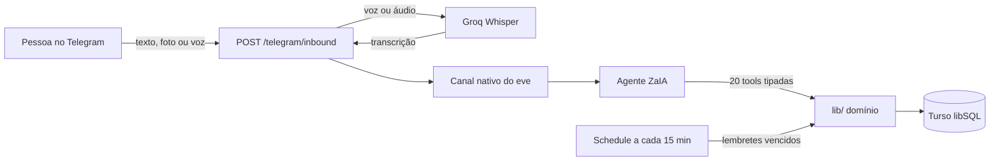

<h1 align="center">ZaIA 🧠</h1>

<p align="center">
  <strong>Assistente pessoal no Telegram que organiza a rotina e funciona como um segundo cérebro.</strong><br/>
  Conversa em português, captura ideias, lembra compromissos e mantém tudo recuperável.
</p>

<p align="center">
  
  
  
  
  
</p>

---

## ✨ O que é

A **ZaIA** é um agente conversacional de uso pessoal que vive no Telegram. Ela combina duas funções no mesmo lugar:

- **Rotina:** tarefas, prazos, prioridades, lembretes e agenda.
- **Segundo cérebro:** ideias, notas, decisões, resumos, referências, projetos e vínculos entre tudo isso.

O objetivo não é ser uma demo, mas uma ferramenta de uso diário: capturar uma tarefa em menos de 10 segundos, não perder lembretes e manter o conhecimento disponível depois de qualquer deploy.

> Escopo do v1: uma única pessoa, em português, usando o Telegram no celular. Sem multiusuário, sem frontend web e sem compartilhamento.

## 🚀 O que ela faz

| Área | Capacidades |
| --- | --- |
| ✅ Tarefas | Criar, listar, atualizar e concluir tarefas com prazo, prioridade e status. |
| ⏰ Lembretes | Agendar avisos, listar, cancelar e consultar a agenda do dia, semana ou período. |
| 🧠 Segundo cérebro | Capturar ideias, notas, decisões e referências; buscar, atualizar e vincular entradas. |
| 📁 Projetos | Agrupar tarefas e conhecimentos por projeto, com status e descrição. |
| 🎤 Áudio | Transcrever mensagens de voz e arquivos de áudio em português antes de responder. |
| 🔔 Proatividade | Um schedule consulta o banco a cada 15 minutos e envia lembretes vencidos. |
| 🔐 Privacidade | Só conversa privada, allowlist obrigatória e nenhum segredo no repositório. |

### 🛠️ 20 ferramentas tipadas

| Área | Ferramentas |
| --- | --- |
| Tempo | `get_current_datetime`, `local_datetime_to_utc` |
| Tarefas | `create_task`, `list_tasks`, `update_task`, `complete_task`, `delete_task` |
| Lembretes | `set_reminder`, `list_reminders`, `cancel_reminder`, `get_agenda` |
| Projetos | `create_project`, `list_projects`, `update_project` |
| Conhecimento | `create_entry`, `get_entry`, `update_entry`, `search_entries`, `link_entries`, `record_decision` |

As tools validam a entrada com Zod, chamam a camada de domínio em `lib/` e nunca falam SQL diretamente. Ações destrutivas, como excluir uma tarefa, pedem aprovação.

## 🧭 Como funciona



1. O Telegram entrega a mensagem em `POST /telegram/inbound`.
2. Se houver voz ou áudio, a rota baixa o arquivo, transcreve com Groq e reescreve o update como texto.
3. O canal nativo valida conversa privada e allowlist.
4. O agente escolhe uma tool; a tool chama `lib/`; `lib/` lê ou escreve no Turso.
5. A resposta volta ao Telegram. O áudio não é persistido.

## 🧱 Stack

| Camada | Tecnologia |
| --- | --- |
| Runtime do agente | [eve](https://eve.dev) 1.x |
| Modelo | `deepseek-v4.1-flash` via opencode-go, reasoning `high`, contexto de 1M tokens |
| Canal | Telegram Bot API + canal nativo do eve |
| Transcrição | Groq `whisper-large-v3-turbo` |
| Banco | Turso (libSQL) com migrações versionadas |
| Deploy | Vercel |
| Linguagem | TypeScript 7 + Zod |

## 📁 Estrutura do repositório

```text
.
├── agent/
│   ├── agent.ts              # modelo e runtime
│   ├── instructions.md       # persona e regras de uso das tools
│   ├── channels/             # eve, Telegram e rota de áudio
│   ├── schedules/            # due-reminders (*/15 * * * *)
│   └── tools/                # 20 tools tipadas com Zod
├── db/
│   └── migrations/           # schema versionado do Turso
├── lib/                      # domínio: tarefas, lembretes, projetos, entradas e tempo
├── knowledge/                # bundle OKF v0.2 com a documentação durável
├── scripts/
│   └── migrate.ts            # runner de migrações
└── package.json
```

## ⚡ Rodando localmente

**Pré-requisitos:** Node.js 26, um banco Turso, um bot no Telegram e, opcionalmente, uma chave da Groq para áudio.

```sh
git clone https://github.com/Concyline/PersonalAssistant.git
cd PersonalAssistant
npm install
```

Crie o `.env.local` (ele é ignorado pelo Git) com:

| Variável | Obrigatória | Uso |
| --- | --- | --- |
| `OPENCODE_GO_API_KEY` | Sim | Acesso ao modelo via opencode-go |
| `TURSO_DATABASE_URL` | Sim | URL `libsql://...` do banco |
| `TURSO_AUTH_TOKEN` | Sim | Token do Turso |
| `TELEGRAM_BOT_TOKEN` | Sim | Bot API: envio, download e webhook |
| `TELEGRAM_BOT_USERNAME` | Sim | Username do bot no canal nativo |
| `TELEGRAM_ALLOWED_USER_ID` | Sim | IDs autorizados, separados por vírgula; sem ela, ninguém é atendido |
| `TELEGRAM_WEBHOOK_SECRET_TOKEN` | Sim | Validação do webhook e do self-fetch |
| `GROQ_API_KEY` | Só para áudio | Transcrição de voz |

Aplique as migrações e inicie a TUI de desenvolvimento:

```sh
npm run db:migrate
npm run dev
```

Para usar o Telegram em produção, registre o webhook em `https://<projeto>.vercel.app/telegram/inbound` com o mesmo `secret_token`. Detalhes em [Telegram](knowledge/integrations/telegram.md).

## ☁️ Deploy

O deploy é feito na Vercel pelo eve:

```sh
npx eve link --project <projeto> --non-interactive
npx eve deploy --non-interactive --yes
```

As variáveis de ambiente precisam existir no projeto da Vercel; o `eve deploy` puxa uma cópia para o `.env.local` local, mas **não** envia segredos locais para a nuvem. O passo a passo completo está em [Deploy](knowledge/operations/deploy.md).

## 🔐 Segurança e privacidade

- Allowlist obrigatória: sem `TELEGRAM_ALLOWED_USER_ID`, o bot não atende ninguém.
- Apenas conversas privadas; grupos e remetentes desconhecidos são ignorados.
- Webhook validado com o secret do Telegram usando comparação em tempo constante.
- Segredos só em `.env.local` e nas variáveis da Vercel; nunca no repositório.
- O áudio é enviado ao Groq apenas para transcrição e não é armazenado no banco.
- Exclusões exigem confirmação explícita.

## 📚 Documentação

O conhecimento durável do projeto vive em [`knowledge/`](knowledge/index.md), um bundle **OKF v0.2**. Comece pelo índice e abra apenas o que precisar.

| Documento | Conteúdo |
| --- | --- |
| [Visão e escopo](knowledge/product/vision.md) | o que é a ZaIA, para quem e o que fica fora do v1 |
| [Arquitetura](knowledge/architecture/overview.md) | fluxo Telegram → eve → Turso e limites |
| [Tarefas](knowledge/domain/tasks.md) · [Lembretes](knowledge/domain/reminders.md) | regras de rotina |
| [Entradas](knowledge/domain/entries.md) · [Projetos](knowledge/domain/projects.md) | segundo cérebro |
| [Telegram](knowledge/integrations/telegram.md) | webhook, allowlist e áudio |
| [Deploy](knowledge/operations/deploy.md) · [Migrações](knowledge/operations/migrations.md) | operação |
| [Commits](knowledge/operations/commits.md) | Conventional Commits com emoji |

## 🗺️ Status do projeto

| Estado | Itens |
| --- | --- |
| ✅ Implementado | Telegram (texto, foto, documento e áudio), tarefas, lembretes, agenda, projetos, entradas, vínculos, decisões, deploy na Vercel e Turso |
| 🚧 Planejado | Preferências duráveis entre conversas, resumo matinal e revisão noturna |
| ⛔ Fora do v1 | Frontend web, multiusuário, WhatsApp, Google Calendar/Gmail, finanças |

## 🧑‍💻 Commits

O repositório segue [Conventional Commits](knowledge/operations/commits.md) com um emoji por tipo:

```text
feat(telegram): ✨ adiciona lembretes automáticos
fix(reminders): 🐛 evita reenvio após marcar sent_at
docs: 📝 atualiza o README de apresentação
```

---

<p align="center">
  Feito com <a href="https://eve.dev">eve</a>, <a href="https://turso.tech">Turso</a>, <a href="https://groq.com">Groq</a> e <a href="https://vercel.com">Vercel</a>.
</p>
